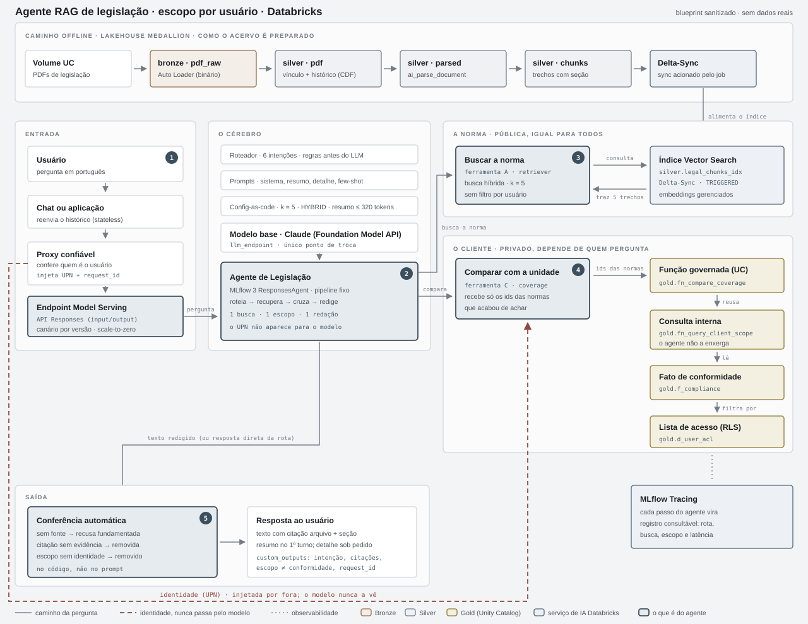
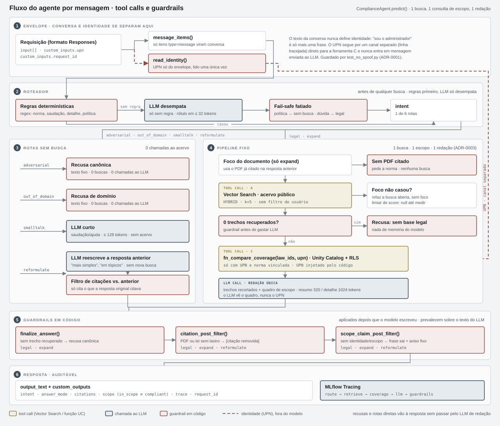
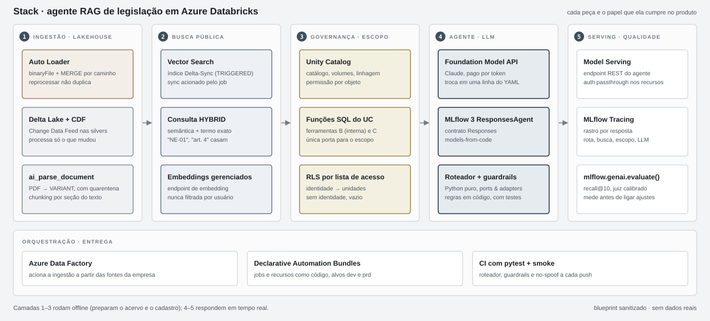

# Agente RAG de Legislação — blueprint

> Esqueleto **sanitizado** de um agente de IA em produção que responde perguntas de
> legislação e conformidade **com escopo por usuário**, construído em Azure Databricks.
> Nenhum dado, nome interno, catálogo ou endpoint da empresa está aqui: o acervo e o
> cadastro em `data/` são fictícios. O desenho, as invariantes e os testes são os mesmos.

## O problema

Os clientes de uma aplicação que gerencia **legislações, artigos e a conformidade de cada
unidade perante eles** precisavam esclarecer dúvidas e entender melhor o contexto de
determinadas normas. Até então, essas perguntas passavam pelo escritório de advocacia
responsável, que respondia caso a caso, consultando manualmente os PDFs das normas e o
cadastro de conformidade de cada cliente.

O escritório queria facilitar esse intermédio: oferecer aos clientes respostas imediatas,
fundamentadas em **todo o acervo já existente dentro da aplicação** — os próprios PDFs das
normas — e **cruzadas com os dados de conformidade de cada cliente**, sem abrir mão de duas
exigências do trabalho jurídico:

- **Rastreabilidade:** cada resposta precisa apontar o documento e o trecho que a sustentam,
  como um parecer faria.
- **Sigilo entre clientes:** a situação de uma unidade só pode ser vista por quem tem vínculo
  com ela.

Isso define o desenho, porque toda pergunta de conformidade tem duas partes:

| Parte | Pergunta | Fonte | Regra |
|---|---|---|---|
| **Pública** | "O que diz a norma?" | Acervo de normas indexado (Vector Search) | Igual para todos: a busca **nunca** é filtrada por usuário |
| **Privada** | "Como a minha unidade está diante dela?" | Cadastro de conformidade (Gold, Unity Catalog) | Só para uma identidade válida, lida **fora** da conversa |

O agente responde as duas na mesma resposta — e diz claramente quando só consegue responder uma.

## Objetivo

Dar a quem cuida de conformidade **uma resposta única, fundamentada e auditável** para as duas
metades da pergunta, sem que o escopo de uma unidade jamais apareça para outro usuário.
Na prática, isso vira quatro compromissos verificáveis:

1. **Toda afirmação tem lastro** em um trecho recuperado do acervo (arquivo + seção); sem
   trecho, o agente recusa em vez de responder de memória.
2. **Escopo só com identidade confiável**, lida do envelope da requisição e nunca do texto da
   conversa; sem identidade, a parte privada é omitida e o usuário é avisado.
3. **Latência e custo previsíveis** por pergunta: no máximo uma busca, uma consulta de escopo e
   uma redação; saudações e pedidos fora da política não tocam o acervo.
4. **Tudo rastreável**: rota, buscas, escopo e chamadas ao LLM ficam no rastro de cada resposta.

Este repositório publica o desenho e as invariantes de forma reproduzível: os testes e o smoke
rodam local em segundos, e os adapters Databricks mostram como ligar cada peça na plataforma.

## Arquitetura

Duas metades: o **caminho offline** (Medallion) prepara o acervo e o cadastro; o **caminho
online** recebe a pergunta, roteia, busca, consulta o escopo e redige. A identidade (linha
tracejada) chega por um canal separado e só alcança a função governada.

### Fluxo do agente: tool calls e guardrails

Cada mensagem percorre um DAG fixo em `ComplianceAgent.predict()`
([`agent.py`](src/legal_agent/agent.py)):

| Etapa | O que acontece | Garantia |
|---|---|---|
| **1 · Envelope** | `message_items()` extrai a conversa; `read_identity()` lê o UPN de `custom_inputs.upn` | O UPN nunca vira mensagem para o LLM ([ADR-0001](docs/adr/0001-identidade-fora-do-modelo.md)) |
| **2 · Roteador** | Regras determinísticas → (sem regra) LLM desempata em ≤ 32 tokens → fail-safe fatiado | Pedido fora da política detectado por regra sempre prevalece; ambíguo segue para `legal` |
| **3 · Rotas sem busca** | `adversarial` e `out_of_domain` → texto fixo; `smalltalk` → LLM curto; `reformulate` → reescreve a anterior | Zero chamadas ao acervo; reescrita não cita nada novo |
| **4 · Pipeline fixo** | **Tool A** (Vector Search HYBRID, sem filtro de usuário) → 0 trechos? recusa → **Tool C** `fn_compare_coverage(law_ids, upn)` → **1** redação | No máximo 1 busca, 1 escopo, 1 LLM ([ADR-0002](docs/adr/0002-busca-publica-sem-filtro.md), [ADR-0003](docs/adr/0003-roteador-e-pipeline-fixo.md)) |
| **5 · Guardrails** | `finalize_answer` → `citation_post_filter` → `scope_claim_post_filter` | O código prevalece sobre o texto do modelo |
| **6 · Resposta** | `output_text` + `custom_outputs` (intent, citations, scope, trace) + MLflow Tracing | Escopo e atendimento em campos separados |

## Destaques

- **Roteador de intenções antes de qualquer busca.** 6 rotas (`legal`, `expand`,
  `reformulate`, `smalltalk`, `out_of_domain`, `adversarial`); regras determinísticas
  primeiro, o LLM só desempata com ≤ 32 tokens. Saudações e pedidos fora da política não tocam o acervo.
- **Pipeline fixo.** 1 busca → 1 consulta de escopo → 1 redação.
  Latência e custo previsíveis ([ADR-0003](docs/adr/0003-roteador-e-pipeline-fixo.md)).
- **Identidade fora do modelo.** O UPN chega por um proxy confiável no envelope da
  requisição, é lido uma vez e só alcança a função SQL governada. O LLM nunca o vê
  ([ADR-0001](docs/adr/0001-identidade-fora-do-modelo.md), guardado por `test_no_spoof.py`).
- **Guardrails em código, não no prompt.** Sem trecho recuperado → recusa canônica;
  citação sem lastro → `[citação removida]`; escopo sem identidade → frase removida.
- **"No escopo" ≠ "conforme".** Posse da norma e atendimento aos artigos saem sempre em
  campos separados, no texto e em `custom_outputs`.
- **Resposta em duas camadas.** Resumo curto no 1º turno; detalhe só quando pedido, com
  busca focada no documento já citado.
- **Config-as-code.** Um YAML com todos os botões; `llm_endpoint` é o único ponto de troca
  do modelo. Limiar de relevância fica `null` até o harness de avaliação medir — nada chutado.
- **Ports & adapters.** O núcleo conhece três protocolos (`LLM`, `Retriever`,
  `CoverageTool`); stubs em memória para testes, serviços Databricks em produção.

## Stack

## Como replicar

Testes, smoke local, estrutura do código e o passo a passo até o endpoint no Databricks estão em
[`docs/como-replicar.md`](docs/como-replicar.md).

## Oportunidades futuras

O desenho deixa pontos de extensão prontos; estes são os próximos passos naturais:

- **Monitoramento contínuo de qualidade.** Scorers do `mlflow.genai` aplicados sobre os rastros
  de produção, com alertas de regressão por rota.
- **Alertas de mudança normativa.** O Change Data Feed das silvers já sabe quais normas mudaram;
  cruzado com o cadastro, ele pode avisar só as unidades afetadas.
- **Pipeline do acervo em um único job declarativo.** Bronze → índice orquestrados ponta a ponta
  por Declarative Automation Bundles, com o sync do índice como última tarefa.
- **Perguntas analíticas via Genie.** Um Genie Space sobre as views Gold com RLS para perguntas
  agregadas ("quantas unidades atendem a NE-02?"), ao lado do agente conversacional.
- **Multi-idioma.** Prompts e rotas por idioma, mantendo o mesmo núcleo e os mesmos guardrails.

## Licença

MIT. Autor: Bruno Lauria.
